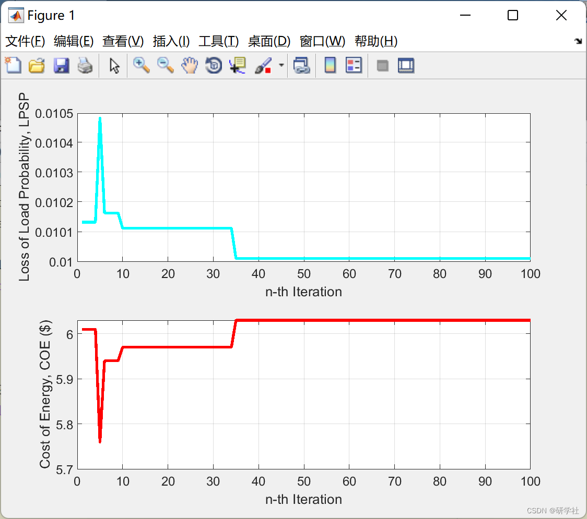

# Optimization of capacitor configuration in power distribution system based on particle swarm optimization algorithm to reduce losses (Matlab code implementation)

🏆 Bloggers' Advantage: 🌞🌞🌞 The content of the blog is as rigorous in thought and clear in logic as possible to facilitate readers.
⛳️ Mantra: A journey of a thousand miles begins with a single step. 📜 1 Overview📚 2 Running Results🎉 3 References🌈 4 MATLAB Code Implementation  
💥 1 Overview  Capacitors are widely installed in distribution networks as means for reactive power compensation, voltage regulation, capacity increase, improved power factor, and economic operation of the grid. Optimizing the installation location, type, and capacity of capacitors in distribution networks under certain constraints is a nonlinear mixed-integer optimization problem. This problem features nonlinearity, discontinuity, diversity of constraints, discreteness of variables, and large computational scale, making conventional optimization methods less effective. As the scale of distribution networks increases, the computational load also significantly increases.  
📚 2 Running Results​ Edit  
Partial code:  
%% Main PSO  
for n_ite=1:set.Niteration  
for n_par=1:set.Nparticle  
[LPSP,COE]=EMS(particle(n_par).position(1),...  
particle(n_par).position(2),...  
particle(n_par).position(3));  
%% Calculate Mark  
Mark=set.weight_LPSP*abs(LPSP-set.desired_LPSP)+...  
set.weight_COE*COE/set.Normal_COE;  
%% Best Particle
if isempty(particle(n_par).best_Mark) || particle(n_par).best_Mark>Mark  
particle(n_par).best_position=particle(n_par).position;  
particle(n_par).best_LPSP=LPSP;  
particle(n_par).best_COE=COE;  
particle(n_par).best_Mark=Mark;  
end  
%% Best Global  
if (n_ite==1 && n_par==1) || best_global.Mark>Mark  
best_global.position=particle(n_par).position;  
best_global.LPSP=LPSP;  
best_global.COE=COE;  
best_global.Mark=Mark;  
end  
log_global(n_ite)=best_global;  
%% Velocity and New Position  
particle(n_par).velocity=set.w*particle(n_par).velocity...  
+set.c1*(particle(n_par).best_position-particle(n_par).position)...  
+set.c2*(best_global.position-particle(n_par).position);  
particle(n_par).position=particle(n_par).position...  
+particle(n_par).velocity;  
%% Round Position  
particle(n_par).position(1)=round(particle(n_par).position(1));  
particle(n_par).position(2)=round(particle(n_par).position(2));  
particle(n_par).position(3)=round(particle(n_par).position(3));  
%% Limit Position  
if particle(n_par).position(1)<set.Npv_min  
particle(n_par).position(1)=set.Npv_min;  
end  
if particle(n_par).position(2)<set.Nbat_min  
particle(n_par).position(2)=set.Nbat_min;  
end  
if particle(n_par).position(3)<set.Ndg_min  
particle(n_par).position(3)=set.Ndg_min;  
end  
if particle(n_par).position(1)>set.Npv_max  
particle(n_par).position(1)=set.Npv_max;  
end  
if particle(n_par).position(2)>set.Nbat_max  
particle(n_par).position(2)=set.Nbat_max;  
end  
if particle(n_par).position(3)>set.Ndg_max  
particle(n_par).position(3)=set.Ndg_max;  
end  
end  
end  
clear LPSP COE Mark n_ite n_par  
%% Show Result  
for n_ite=1:set.Niteration  
LPSP(n_ite)=log_global(n_ite).LPSP;  
COE(n_ite)=log_global(n_ite).COE;  
end  
🎉3 References
🌈4 Matlab code implementation

## Images

<!-- PAYMENT_BLOCK -->

## Get this dataset

- Payment link (Stripe): [Buy now](https://buy.stripe.com/3cs8yP7sY87d0vu9AB)
- Payment QR code: 

<!-- /PAYMENT_BLOCK -->
